 

Hello Everyone👋. My Name ${\color{fuchsia}Firdaus \space \color{fuchsia}Attalea}$ , people usually call me ${\color{fuchsia}Aye}$. I'm an Information Systems graduate from Brawijaya University with over a year of hands-on experience in Product Management, UI/UX Design, and Project Management. Currently working as a <strong>Product at PT CIMB Niaga Tbk.</strong>, where I focus on optimizing user flows and accessibility. Passionate about bridging business goals and technical teams through user research, Agile delivery, and data-driven insights (SQL, Power BI, Tableau). Always eager to collaborate and learn from the community. Let's innovate and create together!
 Currently focusing at <strong>Product Management, UI/UX Design & Data Analytics :D</strong>

<h1 dir="auto"></h1>
<h3 align="left">Connect with me:</h3>

<h1 dir="auto"></h1>
<h3 align="left" > Language: 

  

<h3 align="left" > Software: 

  

  
<h1 dir="auto"></h1>
<h3> My Streaks: </h3>

<br\>  

<h1 dir="auto"></h1>

<picture>
  <source media="(prefers-color-scheme: dark)" srcset="https://raw.githubusercontent.com/firdausattalea/firdausattalea/output/pacman-contribution-graph-dark.svg">
  <source media="(prefers-color-scheme: light)" srcset="https://raw.githubusercontent.com/firdausattalea/firdausattalea/output/pacman-contribution-graph.svg">
  
</picture>

